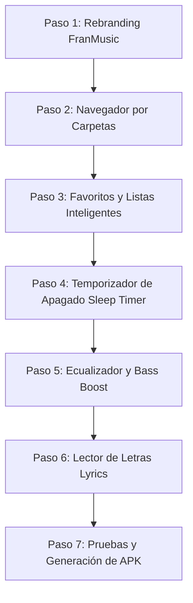

# Plan de Implementación: FranMusic 🎵

> **Visión**: Reproductor de música Android moderno, enfocado principalmente en la biblioteca local con alto rendimiento, estética premium en Jetpack Compose (Material 3) y funciones "plus" de alto valor para el usuario.

---

## 📋 Resumen de Fases

---

## 🛠️ Detalle de los Pasos

### Paso 1: Rebranding e Identidad Oficial (FranMusic)
* **Objetivo**: Establecer el nombre oficial de la app y actualizar la estructura del proyecto.
* **Tareas**:
  * Actualizar `app_name` a **FranMusic** en `strings.xml`.
  * Cambiar `applicationId` y `namespace` a `com.francisco.franmusic` en `app/build.gradle.kts`.
  * Migrar el paquete base a `com.francisco.franmusic`.
  * Actualizar el header visual de la UI con la marca FranMusic.
* **Criterio de Aceptación**: Compilación limpia bajo el nuevo namespace `com.francisco.franmusic`.

---

### Paso 2: Navegador por Carpetas (*Folder Explorer* - Plus #1)
* **Objetivo**: Permitir navegar y reproducir música según las carpetas reales del almacenamiento interno y tarjeta SD.
* **Tareas**:
  * Modificar `LocalMediaSource` para extraer la ruta de directorio (`DATA` o `RELATIVE_PATH`).
  * Crear el modelo `Folder(path: String, name: String, songCount: Int)`.
  * Añadir pestaña **Carpetas** en la pantalla Biblioteca.
  * Implementar vista de lista de carpetas y vista de canciones contenidas en una carpeta.
  * Botón de acción rápida: **Reproducir Carpeta Completa** (encola automáticamente todas las canciones de esa carpeta).
* **Criterio de Aceptación**: Se pueden explorar las carpetas físicas (`Música`, `Descargas`, etc.) y reproducir carpetas enteras con un toque.

---

### Paso 3: Sistema de Favoritos y Listas Inteligentes (Plus #2)
* **Objetivo**: Acceso inmediato a la música favorita y listas generadas por hábitos de escucha.
* **Tareas**:
  * Añadir campos `isFavorite: Boolean` y `playCount: Int` a la base de datos Room (`SongEntity`).
  * Integrar botón de **Corazón (❤️)** en:
    * El Mini Player flotante.
    * La pantalla completa *Now Playing*.
    * Los ítems de la lista de canciones.
  * Generar listas automáticas en la pestaña de Playlists:
    * **❤️ Canciones Favoritas**
    * **🕒 Escuchadas Recientemente**
    * **🔥 Las Más Reproducidas**
* **Criterio de Aceptación**: Tocar el corazón añade/quita la canción de Favoritas al instante con persistencia en Room.

---

### Paso 4: Temporizador de Apagado (*Sleep Timer* - Plus #3)
* **Objetivo**: Programar el apagado automático de la música para dormir sin agotar la batería.
* **Tareas**:
  * Crear clase `SleepTimerManager` con `CountDownTimer` o `Coroutine`.
  * Opciones seleccionables:
    * 15 minutos
    * 30 minutos
    * 45 minutos
    * 60 minutos
    * "Al terminar la canción actual"
  * Desvanecimiento progresivo de volumen (*fade out*) durante los últimos 30 segundos antes de pausar la reproducción.
  * Diálogo modal accesible desde el menú del reproductor *Now Playing*.
* **Criterio de Aceptación**: Al vencer el tiempo, el volumen baja suavemente y el reproductor pausa la música liberando recursos.

---

### Paso 5: Ecualizador Nativo y Refuerzo de Graves (*Bass Boost* - Plus #4)
* **Objetivo**: Mejorar la fidelidad y potencia acústica para auriculares y altavoces.
* **Tareas**:
  * Vincular `android.media.audiofx.Equalizer` y `android.media.audiofx.BassBoost` al `audioSessionId` de ExoPlayer en `PlaybackService`.
  * Crear pantalla o panel de control de audio en Compose:
    * Switch activar/desactivar ecualizador.
    * Selector de Presets: Normal, Rock, Pop, Clásica, Heavy Metal, Jazz, Baile.
    * Slider de Refuerzo de Graves (*Bass Boost* 0-100%).
    * Sliders de 5 bandas de frecuencia (60Hz, 230Hz, 910Hz, 3.6kHz, 14kHz).
  * Persistir la configuración en DataStore para aplicarla automáticamente en cada inicio.
* **Criterio de Aceptación**: Los cambios en las bandas y presets modifican en tiempo real la salida de audio de ExoPlayer.

---

### Paso 6: Lector de Letras Locales y Abiertas (*Lyrics* - Plus #5)
* **Objetivo**: Visualizar letras sincronizadas o estáticas mientras suena la canción.
* **Tareas**:
  * Detección de archivos `.lrc` o `.txt` con el mismo nombre en la carpeta de la canción.
  * Conexión fallback con la API libre y abierta [LRCLIB](https://lrclib.net) (sin necesidad de cuenta ni scraping).
  * Componente visual en el reproductor para alternar entre Carátula y Letra.
  * Resaltado de línea activa en letras sincronizadas tipo karaoke.
* **Criterio de Aceptación**: Canciones con archivo `.lrc` o presentes en LRCLIB muestran su letra en la pantalla de reproducción.

---

### Paso 7: Pruebas Unitarias, Verificación y APK Final
* **Objetivo**: Garantizar cero regresiones y entregar el ejecutable listo para usar.
* **Tareas**:
  * Pruebas unitarias para:
    * Detección y agrupación de carpetas.
    * Lógica de favoritos y listas automáticas.
    * Temporizador de apagado.
  * Compilación con `./gradlew assembleDebug test`.
  * Generación del APK `FranMusic-debug.apk`.
* **Criterio de Aceptación**: Todos los tests en verde y APK generado listo para instalar.
